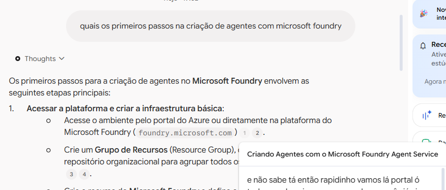

# Segundo Cérebro: Preparação para a Certificação Microsoft AI-103

Repositório desenvolvido para o desafio de projeto do bootcamp da DIO, documentando a criação de um segundo cérebro interativo via Gemini Notebook (NotebookLM).

## 🎯 Objetivo
> "Construir uma base de conhecimento ativa e especializada nos conceitos práticos e teóricos da certificação Microsoft AI-103, orientada ao desenvolvimento e orquestração de agentes de IA através do Microsoft Foundry e Azure."

---
## 📚 Curadoria de Fontes e Justificativa de Confiança

As fontes foram selecionadas priorizando documentação curricular primária e workshops práticos homologados para o exame AI-103:

### 📄 Fontes de Texto
* **[Guia Oficial de Estudos - Exame AI-103](https://learn.microsoft.com/pt-br/credentials/certifications/resources/study-guides/ai-103)**
  * **Origem:** Microsoft Learn
  * **Critério de Confiança:** Documentação normativa primária da Microsoft, contendo o escopo completo de habilidades avaliadas, mudanças de nomenclatura (Foundry) e arquitetura de referência.

### 🎥 Fontes em Vídeo
* **[Workshop 1: Criando Agentes com o Microsoft Foundry Agent Service](https://www.youtube.com/watch?v=xcg2Qbpqu9s)**
  * **Origem:** DIO (Mentoria Microsoft Week AI-103) - Instrutora: Valéria Batista
  * **Critério de Confiança:** Demonstração prática do fluxo de criação do agente, configuração do System Prompt / diretrizes de comportamento e parametrização de modelos no playground do Foundry.
* **[Workshop 2: RAG na Prática com Microsoft Foundry e Azure AI Search](https://www.youtube.com/watch?v=IYqecTKO-go)**
  * **Origem:** DIO (Mentoria Microsoft Week AI-103) - Instrutora: Valéria Batista
  * **Critério de Confiança:** Arquitetura detalhada de RAG (Grounding), integração com Azure AI Search para indexação/vetorização semântica e armazenamento seguro em Azure Blob Storage para evitar alucinações.
---

## ⚙️ Diretriz de Comportamento (System Prompt)
```text
Atue como um arquiteto de soluções e especialista na certificação Microsoft AI-103. 
Responda às dúvidas técnicas sintetizando com precisão os conceitos contidos estritamente nas fontes fornecidas.
Destaque nomes de serviços (Microsoft Foundry, Azure AI Agent Service), passos de configuração e boas práticas.
Sempre ancore as respostas nos trechos de referência das aulas e documentações oficiais.
```

## 💬 Validação e Citações
Pergunta Realizada:
"Quais os primeiros passos na criação de agentes com Microsoft Foundry?"

Resumo da Resposta: Acesso e criação de infraestrutura básica (Resource Group e recurso no Foundry), escolha e deployment do modelo de linguagem (LLM base), e configuração das instruções de sistema / regras de negócio.

Fontes Validadas: Trechos extraídos do workshop da DIO sobre configuração inicial no portal do Azure e Foundry.

Evidência da Consulta com Citações:



## 📦 Artefatos Produzidos no Estúdio

Aceda aos materiais complementares gerados a partir da síntese das fontes:

* 📄 **Blueprint de Arquitetura RAG:** [Azure_RAG_Architecture_Blueprint.pdf](./Azure_RAG_Architecture_Blueprint.pdf)
* 🧠 **Mapa Mental do Ecossistema:** [NotebookLM Mind Map.png](./NotebookLM%20Mind%20Map.png)
* 🎬 **Vídeo Explicativo sobre Grounding:** [Como_o_RAG_Impede_Mentiras_da_IA.mp4](./Como_o_RAG_Impede_Mentiras_da_IA.mp4)


🔗 Link de Acesso ao Gemini Notebook
Caderno de Estudos Compartilhado: Acessar Gemini Notebook AI-103 https://notebook.google.com/notebook/f970bf93-ba69-4dc1-a973-2c98e14d9ada
